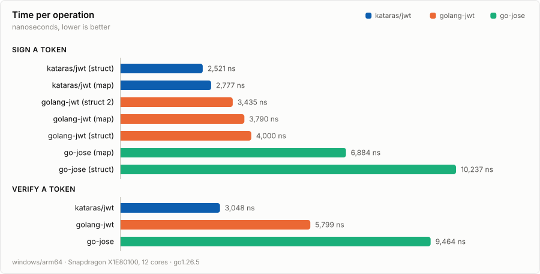
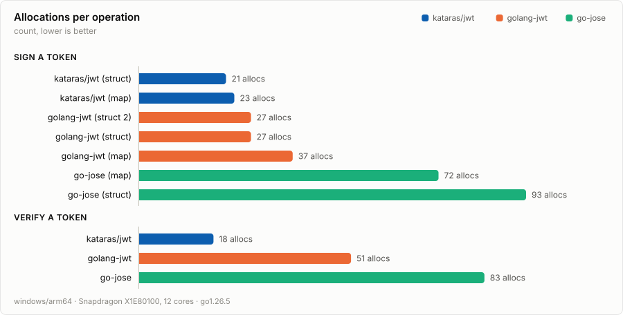
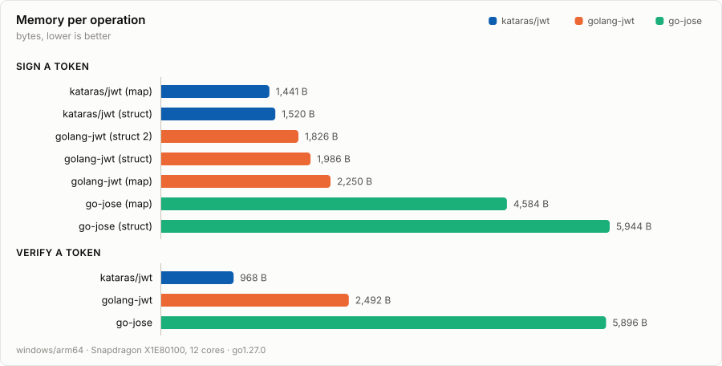

# Benchmarks

Comparison between [kataras/jwt](https://github.com/kataras/jwt),
[golang-jwt/jwt](https://github.com/golang-jwt/jwt) and
[go-jose/go-jose](https://github.com/go-jose/go-jose), signing and verifying the same
HS256 token.

This is a separate Go module. The comparison libraries are its dependencies and never reach
the library's own `go.mod`, which has none.

## Results







Allocations are the number to watch. They are the stable signal between runs, while the
timings move with whatever else the machine is doing, and they are what the library's
release checks are written against.

### System

|    |    |
|----|:---|
| Processor | Snapdragon(R) X 12-core X1E80100 @ 3.40 GHz |
| RAM | 15.61 GB |
| OS | Microsoft Windows 11 Home, ARM 64-bit |
| Go | go1.27.0 windows/arm64 |

### Sign

```sh
BenchmarkSign_Map-12                      694017       1868 ns/op       1441 B/op       27 allocs/op
BenchmarkSign_Struct-12                   754218       1566 ns/op       1520 B/op       23 allocs/op

BenchmarkSign_jwt_go_Map-12               392374       2955 ns/op       2250 B/op       43 allocs/op
BenchmarkSign_jwt_go_Struct-12            614936       2512 ns/op       1986 B/op       30 allocs/op
BenchmarkSign_jwt_go_Struct2-12           667363       2185 ns/op       1826 B/op       30 allocs/op

BenchmarkSign_go_jose_Map-12              345763       5158 ns/op       4584 B/op       72 allocs/op
BenchmarkSign_go_jose_Struct-12           181594       6587 ns/op       5944 B/op       93 allocs/op
```

### Verify

```sh
BenchmarkVerify-12                       1000000       1193 ns/op        968 B/op       12 allocs/op

BenchmarkVerify_jwt_go-12                 405441       3515 ns/op       2492 B/op       42 allocs/op
BenchmarkVerify_go_jose-12                163896       6320 ns/op       5896 B/op       83 allocs/op
```

## Running them

```sh
go test -bench=. -benchmem -run=XXX
```

## Redrawing the charts

`chart/` reads `go test -bench` output and writes the three SVG files above. It uses only
the standard library, so it adds nothing to this module's dependencies, and it emits a
plain SVG document rather than calling a chart library, so the output is deterministic and
renders anywhere an `` does. A `prefers-color-scheme` block adapts it to light and
dark pages.

```sh
go run ./chart                                  # run the benchmarks, then draw
go run ./chart -in bench.txt                    # draw from a run you already have
go run ./chart -note "Ryzen 9 7950X, 16 cores"  # add the CPU, which go test omits on arm64
```

Regenerate after any change that could move the numbers, and update the tables above from
the same run, so the charts and the text cannot disagree.
